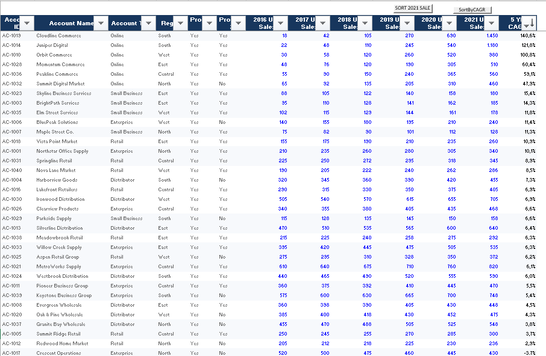

# Excel VBA Sales Automation

## Project Overview

Developed an Excel-based automation solution using Visual Basic for Applications (VBA) to streamline repetitive sales data analysis tasks.

The project focuses on automating customer account sorting based on annual sales performance and compound annual growth rate (CAGR).

Using Excel's Macro Recorder, I created and tested two VBA macros and integrated them with worksheet buttons to enable one-click execution.

This project was developed as part of my practical learning through the Forage Excel Skills simulation, with a focus on applying automation techniques to business reporting and financial analysis.

## Project Objectives

The primary objectives of this project were to:

- Automate repetitive sales data sorting tasks.
- Identify high-performing customer accounts based on annual unit sales.
- Rank customer accounts by their historical growth rates.
- Reduce the need for repetitive manual sorting.
- Develop practical VBA automation skills applicable to financial and operational reporting.

## Tools & Technologies

- Microsoft Excel
- Visual Basic for Applications (VBA)
- Excel Macro Recorder
- Excel Form Controls
- Data Sorting and Filtering
- CAGR Analysis
- Business Performance Analysis

## Dataset Description

The project uses a training dataset containing sales information for 40 customer accounts across the period 2016–2021.

The dataset includes:

| Field | Description |
|---|---|
| Account ID | Unique customer account identifier |
| Account Name | Customer account name |
| Account Type | Customer segment classification |
| Region | Geographical region |
| Product 1 | Product 1 adoption indicator |
| Product 2 | Product 2 adoption indicator |
| 2016–2021 Unit Sales | Historical annual sales volumes |
| 5-Year CAGR | Compound annual growth rate |

The dataset provides a foundation for evaluating customer performance and demonstrating Excel automation techniques.

## VBA Automation Implemented

### 1. Automated Sorting by 2021 Unit Sales

**Macro Name:** `Sort2021Sales`

Created a VBA macro to automatically sort customer accounts by their 2021 unit sales in descending order.

**Functionality:**

- Sorts customer accounts from highest to lowest annual unit sales.
- Enables quick identification of high-volume accounts.
- Executes the sorting operation through a worksheet button.
- Eliminates the need to repeat the same manual sorting steps.

**Business Application:**

Supports sales performance monitoring by allowing users to identify customer accounts contributing the highest sales volumes.

### 2. Automated Sorting by 5-Year CAGR

**Macro Name:** `SortByCAGR`

Developed a second VBA macro to rank customer accounts based on their five-year compound annual growth rate.

**Functionality:**

- Sorts customer accounts by CAGR in descending order.
- Identifies accounts demonstrating relatively high historical growth.
- Enables one-click execution through a dedicated Excel button.
- Supports comparison of customer account growth performance.

**Business Application:**

CAGR analysis helps assess historical growth patterns and identify customer accounts that may warrant further commercial or financial analysis.

The analysis considers growth rates over the 2016–2021 period.

## Automation Workflow

The automation process follows these steps:

**1. Data Preparation**

Organized the account sales dataset in Microsoft Excel with appropriate column headings and consistent data structure.

**2. Macro Recording**

Used Excel's Macro Recorder to capture sorting operations and automatically generate VBA code.

**3. VBA Code Inspection**

Reviewed the generated VBA instructions in the Visual Basic Editor to understand how recorded Excel actions are translated into executable code.

**4. Button Integration**

Created worksheet buttons using Excel Form Controls and assigned the recorded macros to them.

**5. Automation Testing**

Tested the macros by changing the sorting order manually and running the corresponding VBA automation to restore the intended descending order.

## VBA Automation Preview

The following screenshot shows the Excel workbook with the two VBA automation buttons and customer sales dataset.

The implemented buttons are:

**SORT 2021 SALES** — Sorts customer accounts by annual unit sales.

**SORT BY CAGR** — Sorts customer accounts by five-year compound annual growth rate.

## Business Insights

The sample dataset demonstrates how historical sales volumes and growth rates can provide different perspectives on customer performance.

### Annual Sales Performance

Sorting customer accounts by 2021 unit sales helps identify high-volume accounts that may be important for sales monitoring and account management.

### Customer Growth Analysis

Sorting accounts by CAGR highlights customers with relatively strong historical growth.

For example, the dataset includes accounts with five-year CAGR values exceeding 100%.

These accounts demonstrate substantial percentage growth over the observed period, although growth rates should also be considered alongside absolute sales volumes.

### Reporting Efficiency

Automating repetitive sorting operations provides a reusable approach to organizing business data.

The same automation principles can be applied to recurring operational reports, management reporting, and financial analysis workflows.

## Skills Demonstrated

Through this project, I gained practical experience in:

- Recording and executing VBA macros.
- Understanding automatically generated VBA code.
- Assigning macros to Excel Form Control buttons.
- Automating repetitive spreadsheet operations.
- Analyzing annual sales volumes and historical growth rates.
- Testing Excel-based automation workflows.
- Using Excel for business performance reporting.

## Potential Business Applications

The techniques demonstrated in this project can be extended to several business functions.

**Financial Controlling:** Organizing financial performance information and supporting recurring reporting activities.

**Sales Reporting:** Identifying high-volume customers and comparing historical sales performance.

**Business Analytics:** Ranking customer accounts and identifying growth patterns.

**Operational Reporting:** Automating routine spreadsheet operations to support more consistent reporting processes.

## Limitations and Future Improvements

The current implementation focuses on automating two predefined sorting operations.

Potential enhancements include:

- Implementing dynamic sorting ranges to accommodate additional customer accounts.
- Adding input validation and error handling.
- Expanding automation to other reporting tasks.
- Integrating Power Query for repeatable data preparation.
- Developing a broader automated reporting workflow.

## How to Use

To run the VBA automation in Excel:

1. Open the macro-enabled workbook (`.xlsm`) in Microsoft Excel Desktop, if the workbook is provided.
2. Enable macros only after reviewing and trusting the file.
3. Navigate to the **Account Sales Data** worksheet.
4. Click **SORT 2021 SALES** to rank accounts by annual unit sales.
5. Click **SORT BY CAGR** to rank accounts by historical growth rate.

The macros can also be accessed through **Developer → Macros**.

## Project Context and Disclaimer

This project was developed for educational and portfolio purposes using a practice dataset from the Forage Excel Skills simulation.

The VBA automation was recorded, configured, and tested as a practical learning exercise.

The dataset represents simulated business information and does not reflect actual company performance.

This project demonstrates foundational VBA automation skills rather than a production-ready financial reporting system.

---

**Project Focus:** Excel Automation | VBA Macros | Sales Performance Analysis | Business Reporting
